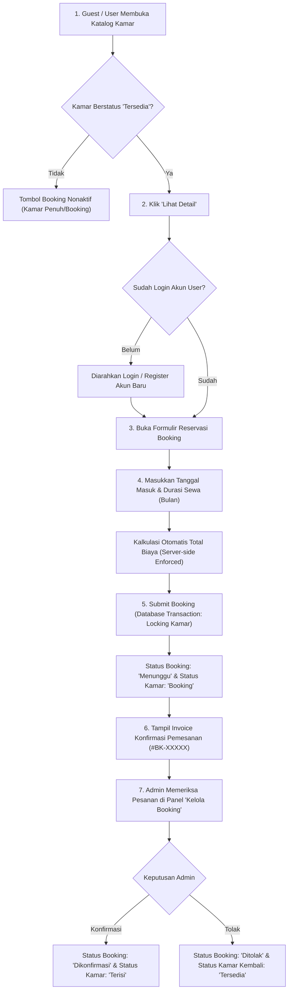

# KosBook — Sistem Booking Kamar Kos Berbasis Web dengan Integrasi AI

Aplikasi sistem informasi dan manajemen reservasi kamar kos berbasis web dengan arsitektur **Model-View-Controller (MVC)** menggunakan **PHP Native** dan basis data **MySQL**, antarmuka responsif berbasis **Bootstrap 5**, serta dilengkapi integrasi **Google Gemini API** yang menghadirkan asisten kecerdasan buatan (*AI Chatbot*) berkarakter ganda: **Fairy 🧚** untuk Calon Penghuni dan **Jarvis 🤖** untuk Administrator.

---

## 1. Identitas Kelompok

| Data Mahasiswa | Keterangan |
|---|---|
| **Nama Pengembang** | Danish Akmal Marchielo |
| **NIM** | 41257182 |
| **Kelas** | TI-1D |
| **Kelompok** | [ISI NOMOR/NAMA KELOMPOK] |
| **Tema Topik Kelompok** | [ISI TEMA TOPIK KELOMPOK SESUAI KEPUTUSAN KELOMPOK] |
| **Mata Kuliah** | Rekayasa Perangkat Lunak (RPL) / Tugas Ujian Akhir Semester (UAS) |

---

## 2. Deskripsi Aplikasi

### A. Latar Belakang & Masalah yang Ingin Diselesaikan
Pengelolaan kamar kos pada umumnya masih dilakukan secara konvensional, seperti pencatatan di buku manual atau pesan singkat melalui aplikasi perpesanan pribadi. Metode manual ini kerap menimbulkan beberapa kendala nyata:
1. **Risiko *Double Booking***: Terjadinya pemesanan ganda terhadap satu unit kamar yang sama pada kurun waktu bersamaan akibat lambatnya pembaruan status ketersediaan.
2. **Ketiadaan Transparansi Informasi**: Calon penghuni kesulitan mengetahui secara pasti fasilitas kamar, spesifikasi, foto aktual, dan tarif sewa bulanan tanpa harus datang langsung ke lokasi untuk survei.
3. **Pencatatan Keuangan dan Operasional yang Tercecer**: Pengelola kos kesulitan memantau ringkasan tingkat keterisian (*occupancy rate*), daftar pesanan yang belum diverifikasi, dan riwayat penyewa yang aktif.

### B. Tujuan KosBook
**KosBook** hadir sebagai platform web terpusat untuk:
- Mendigitalisasi katalog kamar kos beserta statusnya (*Tersedia*, *Dibooking*, *Terisi*) secara *real-time*.
- Memberikan mekanisme transaksi reservasi yang aman dengan kepastian konsistensi data (*ACID transactions*).
- Menyediakan saluran komunikasi cerdas berbasis AI untuk mempermudah calon penghuni berkonsultasi mengenai kamar serta membantu pengelola kos menganalisis data operasional.

### C. Pengguna Aplikasi
Aplikasi KosBook memiliki 3 kategori pengguna:
1. **Tamu (Guest)**: Pengunjung umum yang belum melakukan login. Dapat menjelajahi landing page, melihat katalog kamar kos, mencari dan memfilter kamar berdasarkan tarif atau fasilitas, melihat detail kamar, serta berkonsultasi dengan chatbot Fairy untuk informasi publik.
2. **Calon Penghuni (User Terdaftar)**: Pengguna yang telah mendaftar dan login. Memiliki hak untuk mengajukan booking sewa kamar kos, melihat bukti konfirmasi invoice pemesanan, memantau riwayat dan status booking di Dashboard pribadi, serta berkonsultasi dengan Fairy mengenai status sewa miliknya.
3. **Pengelola Kos (Administrator)**: Pemilik atau staf kos yang bertanggung jawab atas pengelolaan data unit kamar (CRUD), validasi dan persetujuan transaksi booking (konfirmasi atau tolak), monitoring 7 metrik analitik di Dashboard Admin, pengaturan konfigurasi AI, serta berinteraksi dengan asisten Jarvis untuk analitik bisnis.

### D. Alur Umum Pemesanan Kamar Kos


---

## 3. Fitur Aplikasi

Seluruh fitur di bawah ini telah diuji dan diimplementasikan secara nyata pada kode program:

### A. Autentikasi & Manajemen Pengguna
- **Registrasi Akun Calon Penghuni**: Formulir pendaftaran akun dengan validasi nama lengkap, keunikan format email, panjang kata sandi minimal 6 karakter, dan pencocokan konfirmasi kata sandi. Kata sandi dienkripsi menggunakan algoritma standar industri Bcrypt (`password_hash()`).
- **Login Sistem**: Pemeriksaan kredensial menggunakan `password_verify()`, regenerasi session ID (`session_regenerate_id()`) untuk menangkal serangan *session fixation*, dan konfigurasi keamanan cookie (`HttpOnly`, `SameSite=Lax`).
- **Logout Aman**: Pembersihan menyeluruh data sesi dari server dan penghapusan cookie sesi di peramban.
- **Pemisahan Hak Akses (Role-Based Access Control / RBAC)**:
  - User biasa diblokir dari seluruh rute administrasi (`dashboard/admin`, `kamar/admin`, `kamar/tambah`, `kamar/edit`, `booking/admin`) dan otomatis dialihkan ke Dashboard User dengan pesan peringatan.
  - Tamu (*Guest*) otomatis dialihkan ke halaman login saat mencoba mengakses fitur terproteksi.
  - Pengguna yang sudah login dicegah mengakses kembali halaman login/register dan diarahkan ke dashboard masing-masing.

### B. Katalog & Pencarian Kamar Kos
- **Tampilan Katalog Responsif**: Penyajian kamar dalam format Bootstrap Card modern dengan visualisasi foto, nomor kamar, tarif bulanan, fasilitas utama, dan badge status hunian.
- **Pencarian Multi-Kriteria**:
  - Filter ketersediaan unit: *Semua*, *Tersedia*, *Dibooking*, *Terisi*.
  - Filter rentang harga: Input tarif minimum dan tarif maksimum, serta pintasan filter estimasi budget dari beranda.
  - Pencarian kata kunci bebas: Mencari kecocokan nomor kamar maupun fasilitas kamar (misal: "AC", "WiFi", "Kamar Mandi Dalam").
  - Pengurutan data (*Sorting*): Urutkan harga termurah, termahal, atau nomor unit kamar secara alfabetis.
- **Halaman Detail Kamar**: Informasi mendalam mencakup foto resolusi tinggi, tarif bulanan, rincian seluruh fasilitas, deskripsi lingkungan kos, status ketersediaan, serta daftar rekomendasi kamar lainnya.

### C. Alur Pemesanan (Booking) Kamar
- **Proteksi Status Kamar**: Tombol pemesanan dinonaktifkan secara otomatis jika kamar tidak berstatus "Tersedia".
- **Validasi Bisnis Ketat**: Tanggal mulai sewa dicegah memilih tanggal lampau; durasi sewa diwajibkan minimal 1 bulan.
- **Perhitungan Total Biaya di Sisi Server**: Total biaya sewa dihitung berdasarkan perkalian tarif kamar dengan lama sewa (`harga * lama_sewa`), kebal dari rekayasa formulir browser.
- **Database Transaction & Row-Level Locking**: Pembuatan pesanan memanfaatkan transaksi database atomik (`SELECT ... FOR UPDATE`):
  1. Memulai transaksi database.
  2. Mengunci baris kamar dan memastikan statusnya masih "Tersedia".
  3. Menyimpan data ke tabel `booking` dengan status `menunggu`.
  4. Mengubah status kamar di tabel `kamar` menjadi `booking`.
  5. Melakukan `commit`. Jika terjadi kesalahan sistem, seluruh tahapan dibatalkan (*rollBack*).
- **Invoice Konfirmasi Pemesanan**: Menampilkan nomor registrasi resmi booking (`#BK-XXXXX`), rincian kamar, tanggal masuk, durasi sewa, total tagihan, dan panduan verifikasi tanpa simulasi pembayaran palsu.

### D. Dashboard Sesuai Role
- **Dashboard User (Calon Penghuni)**:
  - Kartu metrik pribadi: *Total Booking*, *Booking Menunggu*, *Booking Dikonfirmasi*, *Booking Ditolak*.
  - Pemisahan visual pesanan: *Booking Aktif*, *Menunggu Verifikasi*, dan *Riwayat Booking Lampau*.
  - **Isolasi Data Ketat**: Calon penghuni hanya dapat melihat dan mengakses data transaksinya sendiri. Sistem menolak upaya manipulasi ID booking milik pengguna lain melalui URL.
- **Dashboard Admin (Pengelola Kos)**:
  - 7 Indikator metrik operasional terpadu: *Total Kamar*, *Kamar Tersedia*, *Kamar Booking*, *Kamar Terisi*, *Total User*, *Total Booking*, dan *Booking Menunggu*.
  - Tabel ringkasan *Booking Terbaru* dan *Kamar Terbaru* dengan akses cepat menuju aksi.
  - Panel daftar pengguna terdaftar.
  - Pintasan cepat menuju konfigurasi AI Chatbot.

### E. Manajemen Admin: Pengelolaan Kamar (CRUD)
- **Tambah Unit Kamar**: Input nomor kamar unik, tarif bulanan, fasilitas, deskripsi, dan upload file foto kamar.
- **Validasi Unggah Berkas**: Validasi ukuran foto maksimal 2 MB, validasi ekstensi (`jpg`, `jpeg`, `png`, `webp`), validasi MIME type, dan pemeriksaan biner gambar (`getimagesize`).
- **Edit Data Kamar**: Memperbarui spesifikasi, tarif, deskripsi, maupun mengganti foto kamar.
- **Ubah Status Cepat**: Mengubah status kamar langsung melalui dropdown di tabel admin.
- **Hapus Kamar**: Menghapus unit kamar dari sistem dengan proteksi integritas relasional (kamar yang memiliki riwayat transaksi ditolak untuk dihapus) serta pembersihan berkas foto fisik dari server secara otomatis.

### F. Manajemen Admin: Pengelolaan Transaksi Booking
- **Monitoring Seluruh Pemesanan**: Menampilkan tabel terstruktur 9 kolom wajib: ID Booking, Nama Pemesan, Email, Nomor Kamar, Tanggal Booking, Tanggal Mulai, Durasi Sewa, Total Biaya, dan Status.
- **Filter Status Pemesanan**: Tab filter cepat untuk menampilkan pesanan *Menunggu*, *Dikonfirmasi*, *Ditolak*, atau *Semua*.
- **Konfirmasi Pemesanan**: Mengubah status booking dari `menunggu` menjadi `dikonfirmasi` dan status unit kamar dari `booking` menjadi `terisi` melalui Database Transaction.
- **Penolakan Pemesanan**: Mengubah status booking dari `menunggu` menjadi `ditolak` dan secara otomatis mengembalikan unit kamar menjadi `tersedia` agar siap dipesan oleh calon penghuni lain.
- **Konfirmasi Dialog Bootstrap**: Setiap aksi persetujuan atau penolakan dilengkapi modal konfirmasi untuk menghindari ketidaksengajaan klik oleh administrator.

---

## 4. Fitur Artificial Intelligence (Google Gemini API)

KosBook terintegrasi langsung dengan **Google Gemini API** melalui backend PHP murni (cURL REST Client ke endpoint `generativelanguage.googleapis.com/v1beta`). Fitur AI ini memiliki dual-persona berbasis peran:

```
                  ┌────────────────────────────────────────┐
                  │          Pengguna Mengirim Chat        │
                  └───────────────────┬────────────────────┘
                                      │
                         [Verifikasi Sesi di Server]
                                      │
                 ┌────────────────────┴────────────────────┐
                 │                                         │
       Role: Guest / User                         Role: Admin
                 │                                         │
        ┌────────▼────────┐                       ┌────────▼────────┐
        │   Fairy 🧚 AI   │                       │   Jarvis 🤖 AI  │
        │ Asisten Publik  │                       │ Asisten Bisnis  │
        └────────┬────────┘                       └────────┬────────┘
                 │                                         │
   Konteks: Kamar Tersedia &                 Konteks: Okupansi Kos,
   Booking Milik Sendiri (Jika Login)        Statistik Booking, Analisis
                 │                                         │
                 └────────────────────┬────────────────────┘
                                      │
                        [Google Gemini API Gateway]
                         (REST v1beta generateContent)
                                      │
                        ┌─────────────▼─────────────┐
                        │ Respons AI Cerdas & Aman  │
                        └───────────────────────────┘
```

### A. Persona Chatbot
1. **Fairy 🧚 (Asisten Calon Penghuni & Tamu)**:
   - **Karakter**: Ramah, santun, komunikatif, dan solutif dalam bahasa Indonesia.
   - **Tugas**:
     - Memberikan informasi kamar kos yang saat ini berstatus "Tersedia", tarif bulanan, dan fasilitasnya.
     - Memandu calon penghuni mengenai tata cara reservasi di KosBook.
     - Menjawab status pesanan sewa **khusus milik akun yang sedang login** (misal: "Kapan tanggal masuk booking saya?").
     - Jika tamu (*Guest*) belum login menanyakan status booking pribadi, Fairy secara sopan mengarahkan tamu untuk masuk ke akunnya terlebih dahulu.
   - **Batasan**: Dilarang mengungkap data transaksi calon penghuni lain, data operasional internal admin, atau daftar pengguna sistem.
2. **Jarvis 🤖 (Asisten Operasional Administrator)**:
   - **Karakter**: Profesional, ringkas, objektif, dan berorientasi data analitik.
   - **Tugas**:
     - Menyajikan persentase tingkat keterisian kamar (*occupancy rate*) secara akurat.
     - Melaporkan rekapitulasi jumlah pesanan yang berstatus *menunggu konfirmasi*, *dikonfirmasi*, *ditolak*, dan *selesai*.
     - Menyajikan perbandingan aktivitas pemesanan bulan berjalan terhadap bulan sebelumnya.
     - Menganalisis nilai komitmen transaksi yang tercatat di sistem kos.
   - **Batasan**: Hanya dapat diakses oleh akun dengan role `admin`. Jarvis tidak memiliki wewenang mengeksekusi mutasi basis data secara langsung via percakapan, melainkan mengarahkan admin ke modul panel kendali resmi.

### B. Keamanan & Proteksi Data AI
- **Verifikasi Role di Sisi Server**: Identitas persona (Fairy vs Jarvis) ditentukan 100% berdasarkan variabel sesi PHP di server. Klien di peramban tidak dapat memanipulasi persona bot.
- **Grounding Data Terkontrol (No Raw SQL Injection)**: AI tidak pernah menerima atau mengeksekusi kueri SQL mentah. Semua data kontekstual diambil melalui layanan backend terstruktur (`ChatbotDataService`) dengan PDO Prepared Statements.
- **Perlindungan Data Sensitif**: Kata sandi, hash kata sandi, token CSRF, token sesi, dan konfigurasi basis data secara eksplisit disaring dan tidak pernah dikirimkan ke dalam konteks prompt AI.
- **Larangan Permintaan Koding**: Sistem dilengkapi filter otomatis (*prompt guard*) yang menolak instruksi untuk menulis script kode program (Python, JS, PHP, dll.) guna menjaga fokus AI hanya pada operasional KosBook.
- **Penyimpanan API Key Aman**: Kunci `GEMINI_API_KEY` disimpan secara eksklusif pada file environment `.env` di lingkungan server lokal. API key tidak pernah dicantumkan pada kode sumber publik, tidak terlihat di source code browser, dan diabaikan oleh Git via `.gitignore`.
- **Failover Model Otomatis**: Layanan `GeminiService` mendukung *fallback model*. Apabila model utama mengalami lonjakan kuota (*HTTP 429*) atau *HTTP 503*, sistem otomatis mengalihkan permintaan ke model cadangan (misal: dari `gemini-2.5-flash` ke `gemini-2.5-flash-lite`).
- **Panel Konfigurasi AI di Admin**: Administrator dapat menguji koneksi API, memuat daftar model aktif langsung dari Google AI Studio, memilih model utama/cadangan, dan menyimpan konfigurasi ke file `.env` tanpa menyunting kode secara manual.

---

## 5. Teknologi yang Digunakan

| Kategori | Teknologi / Pustaka | Keterangan Implementasi |
|---|---|---|
| **Bahasa Pemrograman** | **PHP 8.x (PHP Native)** | Murni OOP (*Object-Oriented Programming*), tanpa framework Laravel/CodeIgniter |
| **Arsitektur Perangkat Lunak** | **Pola MVC (Model-View-Controller)** | Pemisahan logika data, pengendali rute, dan antarmuka dengan *Front Controller Pattern* |
| **Basis Data** | **MySQL / MariaDB** | Engine InnoDB, Foreign Key Relational, Prepared Statement PDO, ACID Transactions |
| **Antarmuka (Frontend)** | **Bootstrap 5.3.3** | Framework CSS responsif (Cards, Modals, Tables, Grid, Badges, Alert Flash) |
| **Ikonografi & Tipografi** | **Bootstrap Icons 1.11.3 & Google Fonts** | Visual ikon modern dan font *Plus Jakarta Sans* |
| **Gaya Kustom** | **Vanilla CSS (CSS3)** | Desain kustom pada `public/css/style.css` dan floating UI pada `public/css/chatbot.css` |
| **Skrip Sisi Klien** | **Vanilla JavaScript (ES6+)** | Pemanggilan API asinkron via `fetch()`, manipulasi DOM, kalkulasi biaya dinamis |
| **Kecerdasan Buatan (AI)** | **Google Gemini API (REST v1beta)** | Integrasi AI multi-model (`generateContent`, `listModels`) untuk asisten Fairy & Jarvis |
| **Web Server Lokal** | **Apache (XAMPP Environment)** | Modul URL Rewrite (`.htaccess`) untuk routing URL bersih (*pretty URL*) |

---

## 6. Struktur Direktori Project

```text
Project-RPL2/
├── .env.example             # Template konfigurasi environment (bebas dari nilai rahasia)
├── .gitignore               # Konfigurasi proteksi berkas rahasia, log, cookie, & temporary
├── .htaccess                # Root redirect ke folder public/
├── index.php                # Root Gateway Router
├── README.md                # Dokumentasi lengkap sistem
├── config/
│   ├── config.php           # Pengaturan aplikasi, deteksi BASE_URL dinamis, helper url & formatRupiah
│   └── database.php         # Koneksi PDO singleton ke database MySQL
├── database/
│   ├── kosbook.sql          # Skema DDL MySQL, foreign keys, index, dan seeder data awal
│   └── migrate.php          # CLI helper untuk inisialisasi & seeder database dalam 1 baris
├── app/
│   ├── core/
│   │   ├── App.php          # Engine Router: routing URL dinamis & pemecahan segmen controller/method
│   │   ├── Controller.php   # Base Controller: pemanggil view dan inisialisasi model
│   │   └── Database.php     # Wrapper PDO: prepared statements, query binding, dan transaksi database
│   ├── helpers/
│   │   └── AuthHelper.php   # Manajemen session, RBAC guards, flash messages, & verifikasi token CSRF
│   ├── models/
│   │   ├── UserModel.php    # Model data akun pengguna (auth, register, cek email, profil)
│   │   ├── KamarModel.php   # Model CRUD kamar, pencarian fleksibel, filter harga, dan statistik kamar
│   │   ├── BookingModel.php # Model transaksi booking, locking kamar, konfirmasi, dan penolakan
│   │   └── RoomModel.php    # Alias backward-compatibility untuk KamarModel
│   ├── services/
│   │   ├── AiConfigService.php    # Manajemen model Gemini API & persistensi berkas .env
│   │   ├── ChatbotDataService.php # Abstraksi akses basis data aman untuk konteks percakapan AI
│   │   ├── ChatbotService.php     # Logika persona Fairy/Jarvis, filter larangan coding, prompt rules
│   │   └── GeminiService.php      # Klien HTTP cURL ke REST API Google Gemini & auto-failover model
│   ├── controllers/
│   │   ├── AuthController.php      # Logika autentikasi: Login, Register, Logout
│   │   ├── BookingController.php   # Alur reservasi user, konfirmasi & penolakan booking oleh admin
│   │   ├── ChatbotController.php   # Endpoint API /chatbot/message, /chatbot/history, /chatbot/clear
│   │   ├── DashboardController.php # Dashboard User, Dashboard Admin, dan endpoint AJAX AI Config
│   │   ├── HomeController.php      # Pengendali halaman utama (Landing Page) & kamar pilihan dinamis
│   │   └── KamarController.php     # Katalog kamar publik, detail kamar, dan operasi CRUD kamar admin
│   └── views/
│       ├── auth/            # login.php, register.php
│       ├── booking/         # admin.php, detail.php, konfirmasi.php, tambah.php
│       ├── components/      # alert.php, chatbot.php, room_card.php
│       ├── dashboard/       # admin.php, user.php
│       ├── home/            # index.php
│       ├── kamar/           # admin.php, detail.php, edit.php, index.php, tambah.php
│       └── layouts/         # header.php, navbar.php, footer.php
├── public/
│   ├── index.php            # Entry point aplikasi (Front Controller utama)
│   ├── .htaccess            # Rewrite rules Apache menuju index.php
│   ├── css/
│   │   ├── style.css        # Desain layout kustom responsif
│   │   └── chatbot.css      # Desain floating widget AI & tema Fairy/Jarvis
│   ├── js/
│   │   ├── script.js        # Script UI umum (smooth scroll, auto focus)
│   │   └── chatbot.js       # Client chat asinkronus via Fetch API tanpa reload halaman
│   └── images/
│       ├── default_kamar.jpg
│       └── kamar/           # Direktori penyimpanan file upload foto kamar
└── tests/                   # 11 Suite Pengujian Otomatis & Master Runner
    ├── run_all.php          # Skrip master runner untuk mengeksekusi seluruh pengujian sekaligus
    ├── test_auth.php        # Pengujian registrasi, login, password hash, dan RBAC
    ├── test_crud_kamar.php  # Pengujian CRUD kamar admin dan validasi upload foto
    ├── test_booking.php     # Pengujian 7 aturan bisnis booking dan Database Transaction
    ├── test_admin_booking.php # Pengujian alur konfirmasi dan penolakan pesanan oleh admin
    ├── test_user_dashboard.php  # Pengujian metrik dashboard user dan isolasi data pribadi
    ├── test_admin_dashboard.php # Pengujian 7 metrik analitik dashboard admin
    ├── test_kamar_pencarian.php # Pengujian filter status, rentang tarif, dan pencarian fasilitas
    ├── test_http_auth.php       # Pengujian alur HTTP end-to-end dan keamanan cookie
    ├── test_security_audit.php  # Audit penetrasi (SQL Injection, XSS, CSRF, URL Tampering)
    ├── test_ai_config.php       # Pengujian fetch model Google Gemini dan persistensi .env
    └── test_chatbot_ai.php      # Pengujian integrasi 26 skenario chatbot AI Fairy & Jarvis
```

---

## 7. Persyaratan Sistem & Instalasi

Pastikan komputer atau server lokal Anda memenuhi spesifikasi berikut:
- **Sistem Operasi**: Windows 10/11, Linux (Ubuntu/Debian), atau macOS.
- **Web Server & PHP**: XAMPP / LAMP / WAMP dengan **PHP versi 8.0** atau lebih tinggi (ekstensi aktif: `pdo_mysql`, `curl`, `json`, `mbstring`, `fileinfo`).
- **Basis Data**: **MySQL versi 5.7+** atau **MariaDB versi 10.4+**.
- **Peramban Web**: Google Chrome, Mozilla Firefox, Microsoft Edge, atau Safari versi terkini dengan dukungan JavaScript aktif.

---

## 8. Langkah Instalasi dan Menjalankan Aplikasi

Ikuti petunjuk instalasi langkah demi langkah di bawah ini:

### Langkah 1: Mempersiapkan Folder Project
1. Unduh atau clone repository ke direktori web root server lokal Anda.
   Jika menggunakan Git:
   ```bash
   git clone [MASUKKAN LINK REPOSITORY GITHUB JIKA ADA]
   ```
2. Pastikan folder project berada pada direktori `htdocs` server web XAMPP, contoh:
   ```text
   C:\xampp\htdocs\Project-RPL2
   ```

### Langkah 2: Mengonfigurasi Berkas Environment (`.env`)
1. Buka Terminal / Command Prompt pada root folder project, lalu salin file template `.env.example` menjadi `.env`:
   - Di Windows (CMD):
     ```cmd
     copy .env.example .env
     ```
   - Di Linux / macOS:
     ```bash
     cp .env.example .env
     ```
2. Buka berkas `.env` menggunakan text editor (VS Code, Notepad, dll.), lalu periksa pengaturannya:
   ```ini
   # Konfigurasi Google Gemini API (Dapatkan gratis di https://aistudio.google.com/app/apikey)
   GEMINI_API_KEY=your_gemini_api_key_here
   GEMINI_MODEL=gemini-2.5-flash
   GEMINI_FALLBACK_MODEL=gemini-2.5-flash-lite

   # Konfigurasi Basis Data MySQL XAMPP (Bawaan XAMPP tanpa password)
   DB_HOST=localhost
   DB_USER=root
   DB_PASS=
   DB_NAME=kosbook_db
   DB_PORT=3306
   ```
   > **Catatan**: Ganti `your_gemini_api_key_here` dengan API Key Gemini milik Anda sendiri agar fitur asisten AI Fairy dan Jarvis dapat aktif. Jika belum memiliki API key, fitur utama aplikasi (katalog, booking, dashboard, CRUD kamar) tetap dapat berjalan normal.

### Langkah 3: Menginisialisasi Database MySQL
Pilih salah satu metode di bawah ini:

- **Metode A: Melalui Perintah Otomatis CLI (Direkomendasikan & Sangat Cepat)**:
  Buka terminal pada folder project dan jalankan:
  ```bash
  C:\xampp\php\php.exe database/migrate.php
  ```
  *Skrip ini akan otomatis membuat basis data `kosbook_db`, menyusun seluruh tabel relasional, foreign keys, index, serta menyuntikkan data demo awal.*

- **Metode B: Melalui antarmuka phpMyAdmin**:
  1. Buka browser dan akses alamat: `http://localhost/phpmyadmin/`
  2. Buat database baru dengan nama: `kosbook_db` (Collation: `utf8mb4_unicode_ci`).
  3. Klik database `kosbook_db`, lalu pilih tab menu **Import**.
  4. Klik tombol **Choose File**, pilih file `database/kosbook.sql` dari folder project.
  5. Gulir ke bawah dan klik tombol **Import / Kirim**.

### Langkah 4: Menjalankan Aplikasi

#### Menggunakan Server Apache XAMPP (Sangat Disarankan)
1. Buka aplikasi **XAMPP Control Panel**.
2. Klik tombol **Start** pada modul **Apache** dan **MySQL** hingga indikator berwarna hijau.
3. Buka peramban web dan akses URL:
   ```text
   http://localhost/Project-RPL2/
   ```
   *(Sistem secara otomatis mengarahkan akses dari root menuju Front Controller `public/index.php`)*.

#### Alternatif: Menggunakan PHP Built-in Server
Jika tidak menggunakan Apache, Anda dapat menjalankannya melalui terminal bawaan PHP:
```bash
cd C:\xampp\htdocs\Project-RPL2
C:\xampp\php\php.exe -S localhost:8000 -t public
```
Lalu akses melalui browser pada alamat: `http://localhost:8000`.

---

## 9. Akun Bawaan (Demo) & Pendaftaran Baru

Aplikasi telah dilengkapi dengan data akun demo terenkripsi Bcrypt yang siap digunakan untuk pengujian dan demonstrasi sistem:

### A. Kredensial Akun Administrator (Pemilik / Pengelola Kos)
- **Akun Admin 1**:
  - Email: `admin@kosbook.com`
  - Password: `admin123`
  - Hak Akses: Dashboard Eksekutif Admin, Manajemen Kamar (CRUD), Konfirmasi & Tolak Booking, Konfigurasi AI Gemini, Chatbot Jarvis.
- **Akun Admin 2**:
  - Email: `pemilik@kosbook.com`
  - Password: `admin123`
  - Hak Akses: Hak penuh administrator pengelola kos.

### B. Kredensial Akun Calon Penghuni (User)
- **Akun User 1**:
  - Email: `ahmad@gmail.com`
  - Password: `user123`
  - Hak Akses: Eksplorasi Kamar, Pengajuan Booking Kamar, Dashboard Pribadi (memiliki 1 pesanan aktif), Chatbot Fairy.
- **Akun User 2**:
  - Email: `siti@gmail.com`
  - Password: `user123`
  - Hak Akses: Pengajuan Booking Kamar, Dashboard Pribadi (memiliki pesanan terkonfirmasi), Chatbot Fairy.
- **Akun User 3**:
  - Email: `budi@gmail.com`
  - Password: `user123`
  - Hak Akses: Pengajuan Booking Kamar, Riwayat Pemesanan Selesai, Chatbot Fairy.

### C. Cara Mendaftarkan Akun Pengguna Baru
1. Buka halaman utama KosBook, lalu klik tombol **Register** pada pojok kanan atas bilah navigasi.
2. Isi nama lengkap, alamat email aktif, dan kata sandi minimal 6 karakter.
3. Klik tombol **Daftar Sekarang**.
4. Setelah berhasil, Anda akan dialihkan ke halaman login untuk masuk menggunakan akun yang baru dibuat.

---

## 10. Panduan Menjalankan Pengujian Otomatis

Untuk memastikan keandalan, stabilitas, dan keamanan kode program sebelum pengumpulan tugas, jalankan suite pengujian otomatis berikut:

```bash
# Menjalankan seluruh 11 suite pengujian sekaligus:
C:\xampp\php\php.exe tests/run_all.php
```

Atau jalankan pengujian secara terpisah per modul:
```bash
# 1. Pengujian Autentikasi & RBAC
C:\xampp\php\php.exe tests/test_auth.php

# 2. Pengujian CRUD Kamar & Upload Berkas
C:\xampp\php\php.exe tests/test_crud_kamar.php

# 3. Pengujian Alur Booking & Database Transaction
C:\xampp\php\php.exe tests/test_booking.php

# 4. Pengujian Konfirmasi & Tolak Booking Admin
C:\xampp\php\php.exe tests/test_admin_booking.php

# 5. Pengujian Dashboard User & Isolasi Data
C:\xampp\php\php.exe tests/test_user_dashboard.php

# 6. Pengujian Dashboard Admin & 7 Metrik KPI
C:\xampp\php\php.exe tests/test_admin_dashboard.php

# 7. Pengujian Pencarian & Multi-Filter Kamar
C:\xampp\php\php.exe tests/test_kamar_pencarian.php

# 8. Pengujian HTTP Flow & Manajemen Sesi
C:\xampp\php\php.exe tests/test_http_auth.php

# 9. Audit Keamanan Siber (SQLi, XSS, CSRF, URL Tampering)
C:\xampp\php\php.exe tests/test_security_audit.php

# 10. Pengujian Konfigurasi AI & Fetch Models Google
C:\xampp\php\php.exe tests/test_ai_config.php

# 11. Pengujian Integrasi Chatbot AI Fairy & Jarvis (26 Skenario)
C:\xampp\php\php.exe tests/test_chatbot_ai.php
```

---

## 11. Tautan Demonstrasi Video YouTube

Tautan rekaman video demonstrasi antarmuka, pengujian fitur, dan presentasi sistem KosBook:

> **Link Video YouTube**:  
> [MASUKKAN LINK VIDEO YOUTUBE DEMONSTRASI PROJECT]

---

## 12. Informasi Pengembang & Catatan Akademik

Project **KosBook** dikembangkan oleh:
- **Nama Pengembang**: Danish Akmal Marchielo
- **NIM**: 41257182
- **Program Studi / Kelas**: Teknik Informatika / TI-1D
- **Kelompok**: [ISI NOMOR/NAMA KELOMPOK]
- **Tujuan Pengembangan**: Pemenuhan tugas Ujian Akhir Semester (UAS) mata kuliah Rekayasa Perangkat Lunak (RPL).

Aplikasi ini dibangun dengan mengedepankan prinsip kode yang bersih (*clean code*), pemisahan tanggung jawab lapisan (*separation of concerns*), keamanan data (*defensive programming*), serta pemanfaatan teknologi kecerdasan buatan modern untuk memberikan nilai tambah nyata bagi pengguna.
